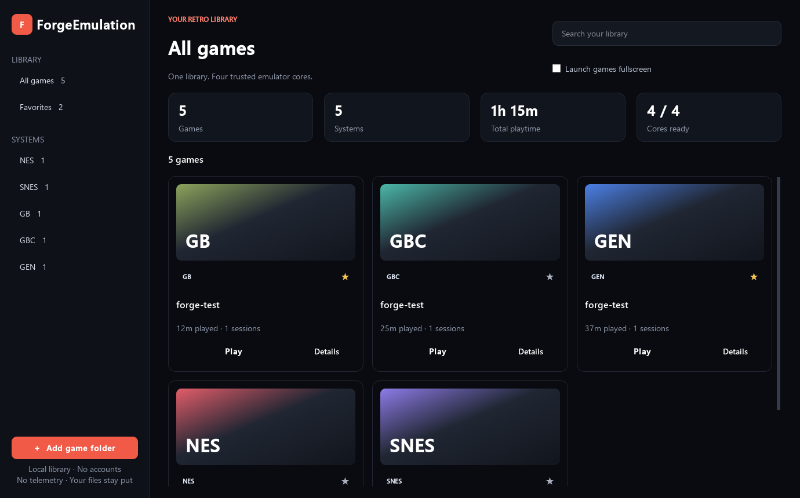
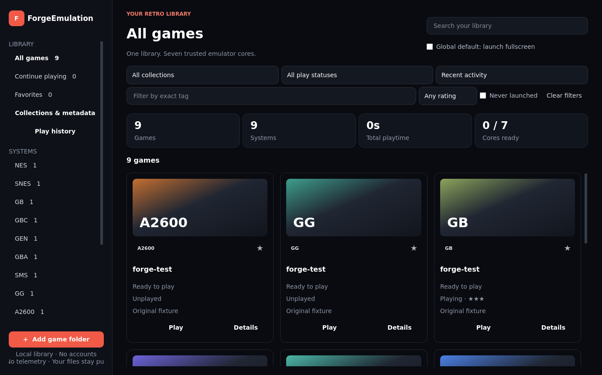
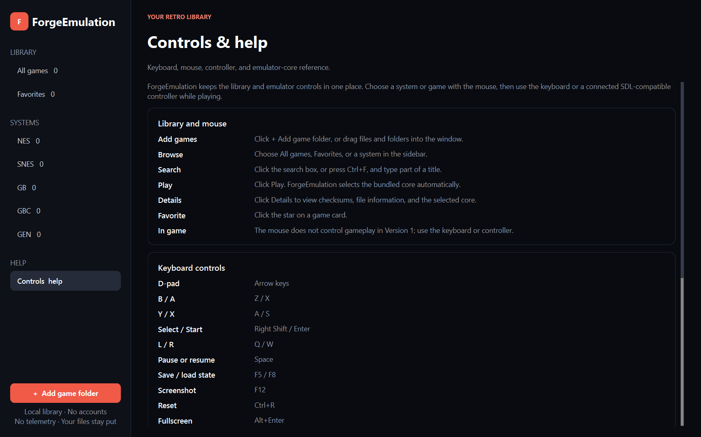

# ForgeEmulation

ForgeEmulation is a local-first Windows desktop library for legally obtained retro games. It scans folders without moving your files, identifies supported cartridges, and launches each game through a pinned, open-source libretro core in an isolated runtime process.

## Features

- Nintendo Entertainment System through Nestopia
- Super Nintendo Entertainment System through bsnes
- Game Boy and Game Boy Color through SameBoy
- Sega Genesis / Mega Drive through BlastEm
- Game Boy Advance through mGBA
- Sega Master System and Game Gear through SMS Plus GX
- Atari 2600 through Stella 2014
- Recursive folder scanning and ZIP inspection
- Search, system filters, favorites, Continue Playing, playtime, and session counts
- Named collections, play status, ratings, notes and tags
- Combined library filters, five sort orders and read-only session history
- Content-matched local organization export/import with preview and recovery
- Keyboard input plus persistent remapping and library navigation for SDL controllers
- Native save RAM, nine save-state slots, screenshots, pause, reset, and fullscreen
- Global and per-game display/audio settings, local backup/restore, diagnostics, titles, and artwork
- No accounts, telemetry, metadata services, or ROM downloads

## Library organization (1.5.0)

Create a collection from **Collections & metadata → New**. Open a game's **Details →
Notes, status & collections**, choose its play status and rating, add comma-separated tags
and notes, and select its collections. Cards show play status and rating. The library's
two filter rows combine collection, status, exact tag, minimum rating and **Never launched**.
Choose recent activity, title, playtime, added date or rating order; **Clear filters** resets
these organization controls. System, favorites and search views still apply. Continue Playing
starts with the 20 most recent games before applying organization filters.

**Play history** lists the latest 200 recorded sessions across the library; the same action
in Details limits history to that game. It shows recorded timestamps, duration, selected core
and exit reason without changing playtime.

**Collections & metadata → Export organization** writes a new JSON file. It includes notes,
tags, ratings, play status, collection names and content identities. Review private notes before
sharing. ROM paths, files, artwork, favorites, title overrides, saves and session history are
excluded. Import previews matching/unknown counts, validates the whole file, skips unknown games
and replaces organization only for matching content already in the library. Collection names
merge. A recovery JSON is saved in userdata/backups before UI replacement; import that file to
restore earlier organization for matching games. Export refuses to overwrite files. Exchange
limits are 8 MiB / 20,000 entries, 50 tags or memberships per game, 80 characters per name,
and 10,000 characters per note. This is manual local exchange, not synchronization.

Organization is stored in the existing library SQLite database and included in normal backups.
Removing a collection removes memberships while keeping every game and its other metadata.
No additional emulator systems, netplay, rewind, achievements or online scraping are claimed.

## Quick start

1. Download and extract the Windows x64 release.
2. Run `ForgeEmulation.exe`.
3. Select **Add game folder** and choose a folder containing games you lawfully possess.
4. Select **Play** on a library card.

Select a system in the sidebar to see the exact bundled emulator core, version,
license, and installation status. Select **Controls & help** or press **F1** for
the complete keyboard, mouse, controller, and core reference inside the app.

ForgeEmulation links to the selected files. It does not rename, move, modify, upload, or distribute them. ZIP members are extracted only into the local application cache when launched.

## Controls

| Action | Keyboard |
|---|---|
| D-pad | Arrow keys |
| B / A | Z / X |
| Y / X | A / S |
| Select / Start | Right Shift / Enter |
| L / R | Q / W |
| Quick menu | Escape or Tab |
| Pause | Space |
| Save state | F5 |
| Load state | F8 |
| Screenshot | F12 |
| Reset | Ctrl+R |
| Fullscreen | Alt+Enter |
| Exit game | Quick menu → Exit game |

Controller buttons use SDL's reported button order; common Xbox-compatible controllers work without configuration.
The mouse operates the library interface but is not mapped to gameplay.

## Controller and library navigation

- Controller settings create an automatic local profile for each connected controller.
- Every gameplay button and D-pad direction can be remapped without changing keyboard controls.
- The library can be navigated with the D-pad or left stick, selected with the configured library
  select button, and backed out of filters or search with the configured library back button.

The in-game quick menu provides state-slot selection, save/load, screenshots, reset,
scaling, filtering, volume, mute, fullscreen, and a deliberate exit action. Backups
include local library data, settings, profiles, saves, states, screenshots, and custom
artwork, but never ROM files.

## Supported files

ForgeEmulation recognizes `.nes`, `.unf`, `.unif`, `.sfc`, `.smc`, `.gb`, `.gbc`,
`.md`, `.gen`, header-verified Genesis `.bin`, `.gba`, `.sms`, `.gg`, and `.a26`
files. It inspects supported files inside ordinary ZIP archives. Multi-file disc
systems and nested archives remain out of scope.

## Legal and privacy

No commercial games, firmware, keys, cover art, or metadata are supplied. Users are responsible for complying with the law where they live. The application does not connect to an online service during normal use.

The frontend is licensed under GPL-2.0-or-later. Bundled cores retain their own licenses. See [THIRD_PARTY_LICENSES.md](THIRD_PARTY_LICENSES.md), [CORE_LICENSE_MATRIX.md](CORE_LICENSE_MATRIX.md), and `third_party/core-manifest.json` for exact versions, hashes, source snapshots, notices, and public-release verification status.

## Development

See [BUILDING.md](BUILDING.md), [TESTING.md](TESTING.md), and [ARCHITECTURE.md](ARCHITECTURE.md). This release is intentionally bounded; it does not include online metadata, a core updater, cloud sync, netplay, shader management, or a managed ROM store.

## Project status

Version 1.5.0 is a Windows release. Bug reports and focused pull
requests are welcome; broader feature work is considered only in a separately
reviewed release.

ForgeEmulation is part of the [Logan Pendragon Forge open-source collection](https://www.loganpendragonforge.com/open-source/).

## Version 1.3.0: reviewed improvements

Add a save-state browser with thumbnails and compatibility warnings, plus guided controller mapping, live input feedback and validated profile exchange.

Browse nine save slots with capture timestamps, core versions and available thumbnails; select the next launch slot without changing game files. State loading rejects a different core version. Controller mapping walks through gameplay and library controls, waits for held controls to be released, and shows live inputs. Versioned profile import validates actions, binding types and limits before previewing replacement counts; export refuses existing files. Core binaries and pins remain unchanged. Automated tests use generated fixtures; physical-controller and user-owned-cartridge acceptance is required before the stable Windows release.

Version 1.3 validation: 53 automated tests passed at 92.03% coverage; packaged frontend and all nine generated-ROM runtime targets passed; ZIP layout and SHA-256 verified. Physical-controller and user-owned-game acceptance is pending.

## Location review (1.4.0)

Choose **Review game locations**, then a readable game folder. The background scan compares stored location paths with that folder and displays file-present, container-present/member-unverified, missing-candidate, unverified and outside-folder results. It never opens ROM contents or changes library flags, metadata, history or saves. Missing/unreadable roots and traversal errors suppress missing candidates. A disconnected mount that still appears as a readable empty folder cannot be distinguished from an empty folder: missing candidates are review evidence, never deletion instructions. ZIP membership, ROM integrity and concurrent filesystem changes are not certified. Only stored locations are reviewed; the command does not find replacements or remove entries. No new core or controller behavior is introduced.

Version 1.4.0 validation covers Windows CI, strict types, dependency audit and CodeQL, plus read-only location-review regressions. The tagged Windows build verifies packaged startup, generated-cartridge runtime targets and archive layout. Interactive location-review acceptance in the packaged Windows app, physical controllers and user-owned games remain unverified.
